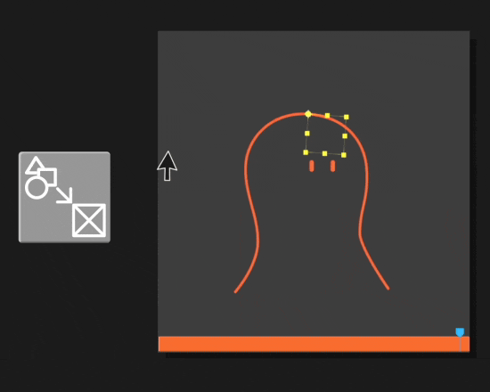
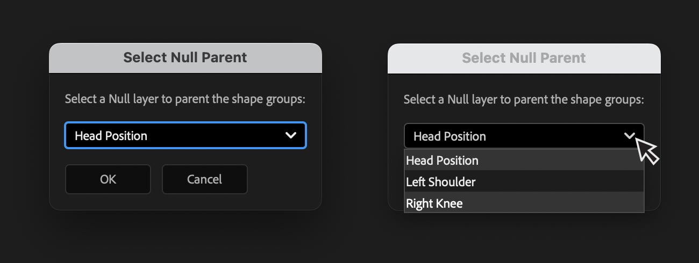
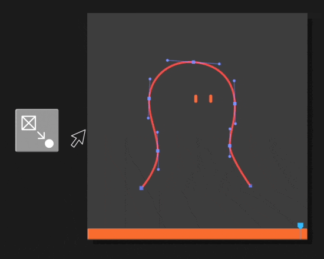
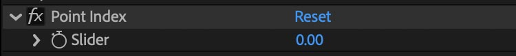
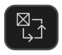
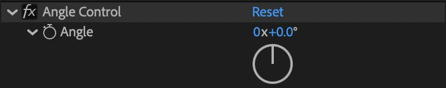

# Linking Tools
---
<h4  id="parent" style="display: flex; align-items: center; gap: 10px;">
  
  <span>1. Parent Shape Groups to Null</span>
</h4>

<br>
<br>
This function allows you to parent shape groups to a null, from within any shape layer.<br>
It has triple function:
<br><br>

| Modifier       | Function | Action                       |
| ------------- | :--------: | --------------------------- |
| -      |    Parent Shape Groups to a Null    | <br><br>**How to use:**<br>1. Select one or more points in the comp viewer or shape groups in the timeline<br>2. Click the button<br>3. A dialog will appear with a dropdown. Select the Null you want to parent your shape groups to.<br><br>The group follows the Null's **position and rotation**, including anything the Null inherits from its own parents. |
| OPT/ALT |   Remove Parent from selected     | Removes the parent from the selected shape groups, keeping current position.|
| SHIFT |  Parent 'Parent' Group   | If the selected shape(s) are nested within another group, when holding shift, the function will target the parent group, not the selected shapes. |

```
💡 TIP: Use this function to add details to your character and speed up cleanup by reusing animations from other elements.
```
---
<h4  id="nulls" style="display: flex; align-items: center; gap: 10px;">
  
  <span>2. Create Nulls to Follow Points</span>
</h4>

<br><br>
This button has double function:
<br><br>

| Modifier       | Function | Action                       |
| ------------- | :--------: | --------------------------- |
| -      |    Create Nulls to follow selected points   |  Similar to the traditional Create Nulls to Follow Points script, with a few key differences:<br><br>- Create Nulls for selected points only <br>- Works on shape paths and mask paths (when **Affect Masks** is enabled)<br>- Works on shape groups parented with **Parent Shape Groups to Null**, and on any transformed group: the Null follows the point through every group transform.<br>- Nulls are linked to shape group or mask path names (not indices) so you can change the stacking order without breaking the connection.<br>- Each null comes with a Point Index slider, allowing you to reposition it if you edit the path by adding or removing points.<br><br>|
| OPT/ALT |  Ignore rotation  | Creates the Nulls without following the path's direction.|


---

<h4  id="pointsfollow" style="display: flex; align-items: center; gap: 10px;">
  
  <span>3. Points Follow Nulls</span>
</h4>

Pins each selected point to a new Null. **Only those points follow**; the rest of the path keeps its animation.

- The Null also controls the point's handles: they rotate and scale with it (negative scale inverts them).
- A **Point Index** slider lets you re-target the Null if points change. Delete the Null to free the point.
- Works on mask paths too (with **Affect Masks** on).

> ⚠️ **Linked paths can't be edited directly.** Use **[Edit mode](#editmode)**.

| Modifier       | Function | Action                       |
| ------------- | :--------: | --------------------------- |
| -      |    Link points   | Select points and click. |
| CMD/CTRL |  Handle Nulls  | Adds In/Out Nulls to control the handles directly. With a point's Null selected, adds or removes its handle Nulls (no edit mode needed). The handles stay where they are. |
| SHIFT |  Edit mode  | See **[below](#editmode)**. |
| OPT/ALT |  Remove  | Removes the selected links (or all links on a selected path/layer). Points go back to their own animation. |
| SHIFT + OPT/ALT |  Remove, keep positions  | Same, but keeps the points where the Nulls hold them at existing keyframes. |

<h5 id="editmode" style="display: flex; align-items: center; gap: 12px; margin-top: 28px; font-size: 1.1em;">
  <span>Editing a linked path (Edit mode)</span>
  <span style="font-family: monospace; font-size: 0.85em; padding: 3px 10px; border: 1px solid #b5b5b5; border-bottom-width: 3px; border-radius: 6px; background: #ffffff; color: #e94934; font-weight: bold;">SHIFT + click</span>
  
</h5>

Linked paths are locked by an expression: you can't select or edit their points. SHIFT-click the button to pause the link and edit the path, **without losing your animation**.

| Action | How |
| ------ | --- |
| **Enter** | Select the path, its layer or any related Null, then **SHIFT-click**. The button switches to its edit-mode icon (above) while any path is paused. |
| **Edit** | Change the free points as usual. Linked points are still driven by their Nulls: move the Null, not the point. |
| **Link more points** | Select them and **click** (CMD/CTRL-click for handle Nulls). This links them and exits edit mode. |
| **Exit** | **SHIFT-click** again, or **click** with nothing selected. |

---

<h4  id="trace" style="display: flex; align-items: center; gap: 10px;">
  
  <span>4. Trace Path</span>
</h4>
This button has double function:
<br><br>

| Modifier       | Function | Action                       |
| ------------- | :--------: | --------------------------- |
| -      |    Create Nulls to trace selected paths   |  Similar to the traditional Trace Path script: it creates a Null that moves around the edge of the path. Has a few key differences compared to the original:<br><br>- Works on shape paths and mask paths (when **Affect Masks** is enabled)<br>- Works on shape groups parented with **Parent Shape Groups to Null**, and on any transformed group.<br>- Nulls are linked to shape group or mask path names, so you can change stacking order without breaking connection <br>- Progress is controlled with an Angle Control, not a slider. That means it's easier to control how many times an element moves around the shape.<br><br>|
| OPT/ALT |  Ignore rotation  | Creates the Null without following the path's direction.|

**Use this to:**
1. Attach other shapes to a path where there's no point and you don't want to create one
2. Have a shape move around another shape

---

<h4  id="controlnulls">Control Nulls</h4>

The Nulls created by **Create Nulls to Follow Points**, **Points Follow Nulls** and **Trace Path** are small **guide shape layers** by default:

- They don't add a Solid to your project for every Null.
- They don't render (guide layers), and they don't show up when the comp is nested.
- Their anchor point sits right on the point.
- Their outlines keep the same thickness on screen at any scale.

You can switch to real **Null layers**, and change their size, colors and stroke width, in [Settings > Control Nulls](interface.md#control-nulls), separately for Points Follow Nulls and for Nulls Follow Points / Trace.

<h4  id="hidenulls">Hide Nulls</h4>


The **Hide Nulls** checkbox at the bottom of the Linking panel hides or shows every Control Null in the active comp, shape layers and real Nulls alike. Unlike the viewer's layer controls toggle, it leaves paths and masks editable. Hidden Nulls keep working: points, paths and parented groups still follow them.

If you toggled some of them by hand, the checkbox only flips the ones that need it.
