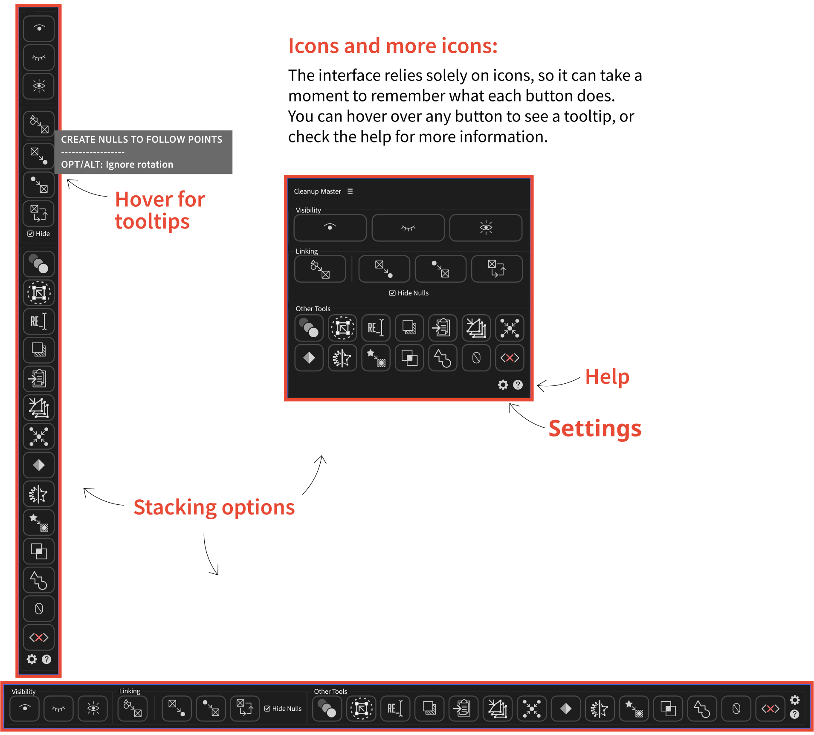
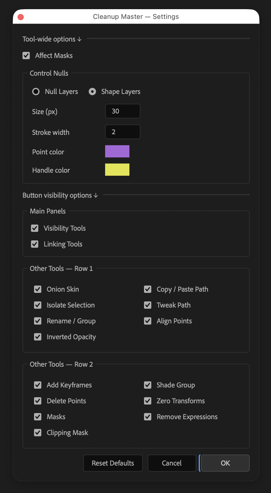

# Interface

---

## Settings

 

Click the **gear icon** at the bottom of the panel to open the Settings window. It's a floating window, so you can keep it open while you work; click the gear again to bring it to the front.

### Tool-wide Options

At the top of the Settings dialog, a **Tool-wide options** section contains global behavior toggles:

| Option | Description |
| ------ | ----------- |
| ☑ **Affect Masks** | When enabled, all buttons that support masks will also work on mask paths. Uncheck to revert all tools to shape-only behavior. |

### Control Nulls

Sets up the Nulls created by **Create Nulls to Follow Points**, **Points Follow Nulls** and **Trace Path**. Changes apply to new Nulls and to the existing ones in the active comp.

| Option | Description |
| ------ | ----------- |
| **Null Layers / Shape Layers** | **Shape Layers** (default): small guide shape layers. No Solids in the project, even outlines at any scale, a line from each handle Null to its point, and a **Hide Nulls** checkbox in the Linking panel. **Null Layers**: real Null layers, all sharing one Solid per kind. Hide them with the viewer's layer controls toggle. Switching only affects new Nulls. |
| **Size (px)** | Size of the point Nulls. Handle Nulls are 40% of it. With Null Layers, this resizes every control Null of that kind in the project. |
| **Stroke width** | Outline thickness (Shape Layers only). |
| **Point color / Handle color** | Click a swatch to pick a color. With Null Layers, the Null uses the closest of your After Effects label colors. |

### Feature Visibility

From the Settings dialog you can also choose which features are visible in the panel. Unchecking a feature hides its button entirely, freeing up space and keeping the toolbar focused on what you actually use.

Features are grouped by section:

| Section | Features |
| ------- | -------- |
| **Main Panels** | Visibility Tools, Linking Tools |
| **Other Tools - Row 1** | Onion Skin, Isolate Selection, Rename / Group, Inverted Opacity, Copy / Paste Path, Tweak Path, Align Points |
| **Other Tools - Row 2** | Add Keyframes, Delete Points, Masks, Clipping Mask, Shade Group, Zero Transforms, Remove Expressions |

Rows are hidden automatically when all their buttons are turned off. Click **Reset Defaults** to turn everything back on and restore the default Control Nulls.

